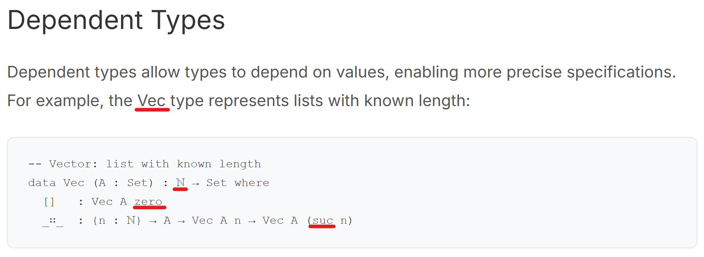

# Web Programming Homework 1

A clean and concise blog homepage built with HTML, CSS, and TypeScript, inspired by minimalist design principles.

## Files Structure

- `index.html` - Main blog homepage
- `post.html` - Individual post page template
- `styles.css` - CSS styling with responsive design and dark mode support
- `data.js` - Shared blog post data and utility functions
- `main.ts` - TypeScript source code for homepage functionality
- `post.ts` - TypeScript source code for individual post pages
- `main.js` - Compiled JavaScript for homepage (generated from TypeScript)
- `post.js` - Compiled JavaScript for post pages (generated from TypeScript)
- `tsconfig.json` - TypeScript configuration

## Development

### Compiling TypeScript
```bash
# Install TypeScript globally first
npm install -g typescript

# Compile main.ts
npx tsc

# Compile post.ts
npx tsc post.ts
```

### Running the Application
Simply open `index.html` in a web browser. The repository already contained compiled TypeScript files.

## 網頁設計概念與內容
靈感來源於 [Donnacha Oisín Kidney
](https://doisinkidney.com/)的個人網站。想設計一個類似部落格的網站存放各種文章。

### 設計理念
採用了簡潔的設計風格，強調內容的可讀性。首頁的部落格列表以卡片式布局呈現，每篇文章都包含標題、摘要與標籤，使用者可以輕鬆瀏覽與篩選。

網站除了提供文字內容外，也支持程式碼區塊，方便使用者閱讀程式與證明。

### 主要功能
- **深色模式**: 網站可在深色與淺色模式之間選擇。
- **搜尋功能**: 可以透過標題、內容或標籤過濾部落格文章。
- **代碼導航**: 在任何 Agda 教學文章(第一篇文章)中，使用者可以點擊帶有連結的型別、函數或建構子名稱，頁面將自動捲動至該代碼區塊，並短暫高亮顯示。
    
    範例：